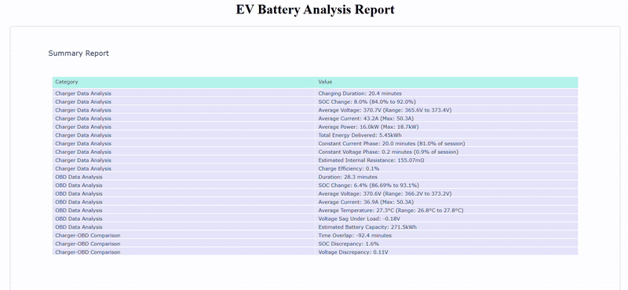

# EV Battery Data Analysis Tool



A Python tool for analysing electric-vehicle battery data logged from a charger
and from the OBD port, with interactive Plotly charts collected into a single
HTML report.

## Features

- **Data loading**: charger and OBD logs from CSV files
- **Analysis**:
  - Charging session metrics (duration, SOC change, power, …)
  - Battery health indicators (internal resistance, voltage sag, …)
  - Charging phase detection (CC/CV)
- **Interactive visualisation**: Plotly charts
- **Unified report**: one HTML file with all results and plots

## Installation

```bash
git clone https://github.com/gueni/ev-battery-analysis-tool.git
cd ev-battery-analysis-tool
pip install -r requirements.txt
```

## Usage

Run the example on the sample logs in `data/`; the report is written to
`output/battery_analysis_report.html`:

```bash
python bat_obd.py
```

Or use the class from your own script:

```python
from bat_obd import EVBatteryAnalyzer

analyzer = EVBatteryAnalyzer(
    charger_file="data/2023051609_charger.csv",
    obd_file="data/2023051609_OBD.csv",
)
analyzer.analyze_data()
analyzer.save_combined_report(output_dir="results")
```

## Example output

The HTML report contains:

- Summary statistics and a battery health assessment
- Time-series plots of voltage, current and SOC
- Power charts
- Voltage–current characteristics
- Charger vs. OBD comparison plots (when both files are given)

A generated example is in [`output/battery_analysis_report.html`](output/battery_analysis_report.html).

## Data format

Both the charger and the OBD CSV need:

- a `datetime` or `timestamp` column
- `voltage` (V)
- `current` (A)
- `soc` (state of charge, %)
- optionally `temperature` (°C)

## Repository layout

```
0013_ev_battery/
├── bat_obd.py          # EVBatteryAnalyzer + example run
├── requirements.txt    # pandas, numpy, plotly
├── data/               # Sample charger and OBD logs (2023-05-16, sessions 01 and 09)
├── output/             # Generated HTML report
└── images/             # Demo GIF used in this README
```

## License

MIT License
